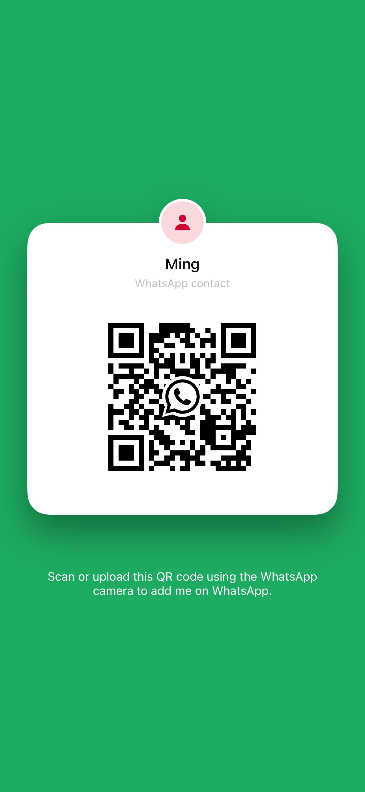

# WhisperASR 直播字幕版

[English](README.md) · [繁體中文（原專案）](README.zh-TW.md)

> 本项目 fork 自 [plateaukao/whisperASR](https://github.com/plateaukao/whisperASR)，专门为**看没有字幕的直播和视频**做了优化：本地实时语音识别，加上免费的云端翻译，大字号字幕直接浮在视频上。
>
> 原版软件归功于原作者 [@plateaukao](https://github.com/plateaukao)。本项目沿用相同的 [Apache License 2.0](LICENSE) 许可证，下面列出了本版本做的修改。

## 本版本改了什么

### 实时字幕窗口
- **描边字幕**：白字加粗黑描边，像电影字幕一样，任何背景下都看得清。翻译行用浅青色，和原文一眼就能区分。
- **字号分档调节**：底部栏的字号按钮，每点一次升一档：18 → 22 → 28 → 34 → 40。
- **背景透明**：底部栏的透明度按钮，在 35% → 15% → 0%（完全透明）→ 55% 之间切换，字幕可以直接盖在视频上。

### 历史记录 / 转录详情页
- **字号单独调节**：工具栏有自己的字号按钮（18 → 22 → 28 → 34 → 40），和实时字幕的字号互不影响。
- **选择复制**：可以用鼠标拖选原文或译文的任意一段，按 Cmd+C 复制。
- **点时间戳跳转**：跳转播放改成点时间戳，拖选文字时不会再误跳音频。

### 设置
- **Appearance（外观）** 里分成两个字号选项：*Live Caption Font*（实时字幕）和 *History Transcript Font*（历史记录）。

### 翻译质量和速度
- 先把 Whisper 切出来的零碎片段**合并成完整句子**再显示和翻译，译文读起来更通顺，不再是一个词一个词地蹦。
- 每次翻译**最多送 6 行**，剩下的自动接着翻，积压时不会变成一个又大又慢的请求。
- 模型返回的行数对不上时，会**自动逐行重新翻译**，译文不会错位或留空。
- 翻译提示词改为要求输出自然完整的句子，请求超时延长到 60 秒。

### 编译
- `swift-tools-version` 降到 6.1，用当前 Xcode / 命令行工具自带的 Swift 就能编译。

## 推荐配置：又快又免费

| 环节 | 用什么 | 费用 |
|---|---|---|
| 语音识别 | **NVIDIA Nemotron 3.5 Multilingual**（流式模型，在本机神经网络引擎上运行） | 免费，离线 |
| 翻译 | **智谱 GLM `glm-4.7-flash`**（兼容 OpenAI 的接口） | 免费 |

Nemotron 是流式模型，字幕延迟很低。体积大的 Whisper 模型转录录音文件更准，但实时用会明显变慢。

## 安装方法

### 1. 准备
- Apple 芯片的 Mac（M1 及以上），macOS 14 或更新
- 安装 Xcode 或命令行工具（终端运行 `xcode-select --install`），Swift 6.1 以上
- Git

### 2. 编译并安装
打开「终端」，依次运行：

```bash
git clone https://github.com/chenzhen0999/whisperASR.git
cd whisperASR
bash Scripts/build_release.sh
cp -R WhisperASR.app /Applications/
xattr -cr /Applications/WhisperASR.app
open /Applications/WhisperASR.app
```

第一次编译要几分钟。`xattr -cr` 用来解除「无法打开未签名应用」的拦截。

### 3. 下载语音识别模型
打开 **Settings**（Cmd+,）→ **Speech Recognition Models**，下载 **Nemotron 3.5 Multilingual** 并选中它。

### 4. 配置免费翻译（智谱）
1. 在 [智谱开放平台](https://open.bigmodel.cn/) 注册，在控制台创建一个 API Key。
2. 在 **Settings → OpenAI Translation API** 里填：
   - **API Endpoint：** `https://open.bigmodel.cn/api/paas/v4`
   - **Model：** `glm-4.7-flash`
   - **API Key：** 你的智谱 Key
3. **Target Language** 选你想看的字幕语言，比如简体中文。

如果 `glm-4.7-flash` 提示访问量过大（错误码 1305），把模型换成同样免费的 `glm-4-flash-250414` 即可。

### 5. 开始看直播字幕
1. 点录音按钮，选择正在播放声音的应用（比如你的浏览器）。
2. 打开实时转录，开始录音。
3. 第一次会要求**屏幕录制**权限：到 系统设置 → 隐私与安全性 → 屏幕录制 里允许，然后重启 App。
4. 用底部栏的按钮调字号和背景透明度。

### 更新
```bash
cd whisperASR && git pull
bash Scripts/build_release.sh
cp -R WhisperASR.app /Applications/
tccutil reset ScreenCapture com.whisperasr.app
```
每次重新编译后签名都会变，所以更新后要重置并重新允许一次屏幕录制。

## 联系与打赏

觉得好用的话，欢迎加我交流，或者请我喝杯咖啡。

| WhatsApp 联系我 | 支付宝 · 打赏博主 |
|---|---|
|  |  |
